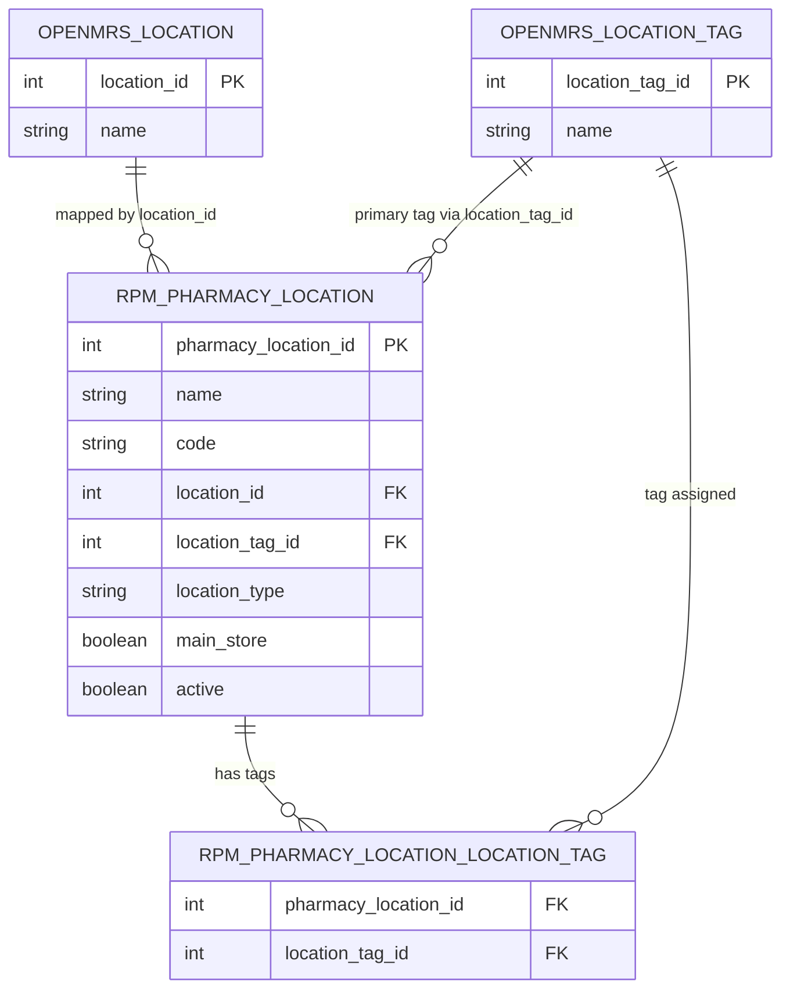
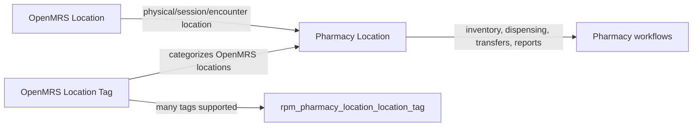

# OpenMRS Location, Location Tag, and Pharmacy Location

## Meaning in the Module

## Current Code Mapping

- `PharmacyLocation.location` maps to `org.openmrs.Location` using `rpm_pharmacy_location.location_id`.
- `PharmacyLocation.locationTag` maps to one primary `org.openmrs.LocationTag` using `rpm_pharmacy_location.location_tag_id`.
- `PharmacyLocation.locationTags` maps to many `org.openmrs.LocationTag` records using `rpm_pharmacy_location_location_tag`.
- The location admin page currently saves selected OpenMRS location tags into `locationTags`, then sets `locationTag` to the first selected tag for backward compatibility.

Relevant files:

- `api/src/main/java/org/openmrs/module/rwandapharmacymanagement/model/PharmacyLocation.java`
- `api/src/main/resources/PharmacyLocation.hbm.xml`
- `omod/src/main/java/org/openmrs/module/rwandapharmacymanagement/page/controller/location/ListPageController.java`
- `omod/src/main/webapp/pages/location/list.gsp`
