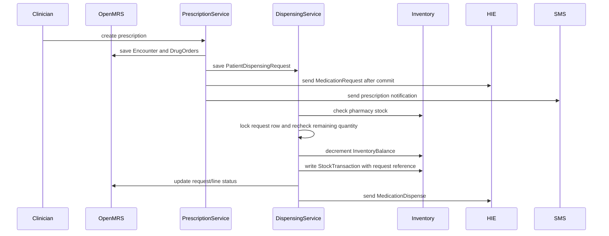
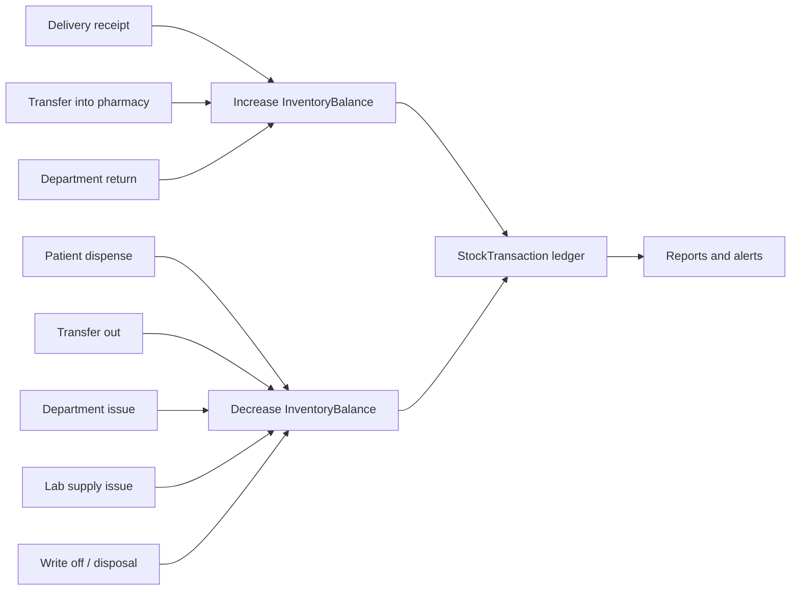

# Whole Pharmacy Connection Diagram

This diagram shows the main connections in the Rwanda Pharmacy Management module.

```mermaid
flowchart TB
    subgraph OPENMRS["OpenMRS core"]
        PATIENT["Patient"]
        VISIT["Visit"]
        ENCOUNTER["Encounter"]
        DRUG_ORDER["DrugOrder / Order"]
        CORE_LOCATION["OpenMRS Location"]
        LOCATION_TAG["OpenMRS Location Tag"]
        USER_PROVIDER["User / Provider"]
    end

    subgraph MASTER["Pharmacy master data"]
        PHARMACY_LOCATION["PharmacyLocation"]
        ITEM["Item"]
        PRODUCT_MASTER["ProductMasterItem"]
        DRUG_LINK["OpenMRS Drug link"]
        SUPPLIER["Supplier"]
        SUPPLIER_PRICE["SupplierPrice"]
        SUPPLIER_MAPPING["SupplierProductMapping"]
    end

    subgraph PRESCRIBING["Clinical request flow"]
        PRESCRIPTION_SERVICE["PrescriptionServiceImpl"]
        PATIENT_REQUEST["PatientDispensingRequest"]
        PATIENT_REQUEST_LINE["PatientDispensingRequestLine"]
        PAYMENT["Patient bill / payment status"]
        DISPENSING_QUEUE["Dispensing queue"]
    end

    subgraph DISPENSING["Dispensing flow"]
        DISPENSING_SERVICE["DispensingServiceImpl"]
        DISPENSE_RECORD["DispenseRecord"]
        DISPENSE_LINE["DispenseRecordLine"]
        SAFETY["ClinicalSafetyService"]
        PRICING["PricingService"]
    end

    subgraph INVENTORY["Stock ledger"]
        INVENTORY_SERVICE["InventoryServiceImpl"]
        BALANCE["InventoryBalance"]
        STOCK_TX["StockTransaction"]
        DELIVERY_RECEIPT["DeliveryReceipt"]
        DELIVERY_LINE["DeliveryReceiptLine"]
        STOCK_ADJUSTMENT["StockAdjustment"]
        TRANSFER["InterPharmacyTransfer"]
    end

    subgraph INTERNAL_REQUESTS["Internal pharmacy requests"]
        PHARMACY_REQUEST["PharmacyItemRequest"]
        DEPT_REQUEST["DepartmentBulkRequest"]
        DEPT_ISSUE["DepartmentStockIssue"]
        DEPT_RETURN["DepartmentStockReturn"]
        LAB_REQUEST["LabSupplyRequest"]
    end

    subgraph SUPPLY["Supplier and RMS"]
        PURCHASE_ORDER["PurchaseOrder"]
        SUPPLIER_ORDER["SupplierOrder"]
        SUPPLIER_INTEGRATION["SupplierIntegrationServiceImpl"]
        RMS["RMS Supplier API"]
    end

    subgraph EXTERNAL["External integrations"]
        COMMUNICATION["PrescriptionCommunicationService"]
        HIE["HIE Medication API"]
        SMS["SMS Gateway"]
        INTEGRATION_LOG["IntegrationLog"]
        RETRY["Retry schedulers"]
    end

    subgraph REPORTING["Admin and reporting"]
        REPORTS["Stock, movement, sales, alerts, integration logs"]
        ALERTS["AlertService"]
        SETTINGS["Settings / global properties"]
    end

    CORE_LOCATION --> PHARMACY_LOCATION
    LOCATION_TAG --> PHARMACY_LOCATION
    PHARMACY_LOCATION --> BALANCE
    PHARMACY_LOCATION --> STOCK_TX

    PRODUCT_MASTER --> ITEM
    PRODUCT_MASTER --> DRUG_LINK
    DRUG_LINK --> DRUG_ORDER
    ITEM --> PATIENT_REQUEST_LINE
    ITEM --> DISPENSE_LINE
    ITEM --> BALANCE
    ITEM --> STOCK_TX
    SUPPLIER --> PURCHASE_ORDER
    SUPPLIER --> SUPPLIER_ORDER
    SUPPLIER_PRICE --> ITEM
    SUPPLIER_MAPPING --> ITEM

    PATIENT --> PRESCRIPTION_SERVICE
    VISIT --> PRESCRIPTION_SERVICE
    CORE_LOCATION --> PRESCRIPTION_SERVICE
    USER_PROVIDER --> PRESCRIPTION_SERVICE
    PRESCRIPTION_SERVICE --> ENCOUNTER
    PRESCRIPTION_SERVICE --> DRUG_ORDER
    PRESCRIPTION_SERVICE --> PATIENT_REQUEST
    PATIENT_REQUEST --> PATIENT_REQUEST_LINE
    PATIENT_REQUEST --> PAYMENT
    PAYMENT --> DISPENSING_QUEUE
    PATIENT_REQUEST_LINE --> DISPENSING_QUEUE

    DISPENSING_QUEUE --> DISPENSING_SERVICE
    DISPENSING_SERVICE --> SAFETY
    DISPENSING_SERVICE --> PRICING
    DISPENSING_SERVICE --> DISPENSE_RECORD
    DISPENSE_RECORD --> DISPENSE_LINE
    DISPENSE_LINE --> BALANCE
    DISPENSE_LINE --> STOCK_TX

    DELIVERY_RECEIPT --> DELIVERY_LINE
    DELIVERY_LINE --> BALANCE
    DELIVERY_LINE --> STOCK_TX
    STOCK_ADJUSTMENT --> BALANCE
    STOCK_ADJUSTMENT --> STOCK_TX
    TRANSFER --> BALANCE
    TRANSFER --> STOCK_TX

    PHARMACY_REQUEST --> TRANSFER
    DEPT_REQUEST --> BALANCE
    DEPT_REQUEST --> STOCK_TX
    DEPT_ISSUE --> BALANCE
    DEPT_ISSUE --> STOCK_TX
    DEPT_RETURN --> BALANCE
    DEPT_RETURN --> STOCK_TX
    LAB_REQUEST --> BALANCE
    LAB_REQUEST --> STOCK_TX

    PURCHASE_ORDER --> SUPPLIER_INTEGRATION
    SUPPLIER_INTEGRATION --> SUPPLIER_ORDER
    SUPPLIER_INTEGRATION --> RMS
    RMS --> DELIVERY_RECEIPT
    DELIVERY_RECEIPT --> SUPPLIER_INTEGRATION
    SUPPLIER_INTEGRATION --> RMS

    PRESCRIPTION_SERVICE --> COMMUNICATION
    DISPENSING_SERVICE --> COMMUNICATION
    COMMUNICATION --> HIE
    COMMUNICATION --> SMS
    COMMUNICATION --> INTEGRATION_LOG
    SUPPLIER_INTEGRATION --> INTEGRATION_LOG
    RETRY --> INTEGRATION_LOG
    RETRY --> HIE
    RETRY --> SMS

    BALANCE --> REPORTS
    STOCK_TX --> REPORTS
    DISPENSE_RECORD --> REPORTS
    INTEGRATION_LOG --> REPORTS
    ALERTS --> REPORTS
    SETTINGS --> COMMUNICATION
    SETTINGS --> SUPPLIER_INTEGRATION
    SETTINGS --> ALERTS
```

## Main Flow

## Stock Movement Summary

## Key Code Anchors

- `PrescriptionServiceImpl` creates OpenMRS encounters/orders and module dispensing requests.
- `DispensingServiceImpl` validates dispensing, applies clinical safety/pricing, reduces stock, and records dispense transactions.
- `DispensingServiceImpl` protects patient-request dispensing from duplicate browser submits and concurrent processing by locking the request row before validating remaining quantities.
- `InventoryServiceImpl` receives deliveries, transfers stock, adjusts stock, and maintains `InventoryBalance` plus `StockTransaction`.
- `SupplierIntegrationServiceImpl` submits purchase orders and delivery confirmations to RMS.
- `PrescriptionCommunicationService` sends HIE and SMS messages and records integration logs.

## Duplicate Dispense Prevention

- The serve form disables submit buttons after client-side validation passes, which prevents accidental double-click submits from the same browser page.
- Patient-request dispensing reloads the request with a database `FOR UPDATE` lock before checking already-dispensed quantities.
- Future patient dispense stock transactions store the request id in `rpm_stock_transaction.reference_number` and include it in the remarks, for example `Dispensed against request #123`.
